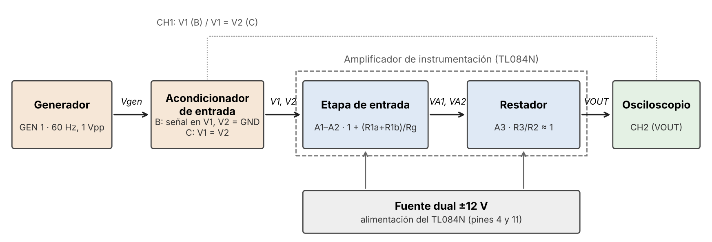

# Laboratorio 3 — Amplificador de instrumentación y rechazo de modo común

Instrumentación Biomédica III · Escuela Profesional de Ingeniería Biomédica · Universidad Nacional Mayor de San Marcos

Archivos de soporte del Informe de Laboratorio N.º 3: esquemático, capturas originales del osciloscopio, fotografías del montaje y datos medidos.

## Integrantes

| Apellidos y nombres | Código |
|---|---|
| Cava León, Elmer Alexis | 23190437 |
| Díaz Melendez, Sofia Marleny | 23190439 |
| Enriquez Villalobos, Cristhian Anghelo | 23190440 |
| Huarcaya Vasquez, Alice Gabriela | 23190121 |

Docente: Dra. María Elisia Armas Alvarado

## Circuito

Amplificador de instrumentación de tres amplificadores operacionales implementado con un TL084N y alimentado con ±12 V:

- **Etapa de entrada (A1–A2):** ganancia diferencial 1 + (R1a + R1b)/Rg.
- **Restador (A3):** ganancia R3/R2 ≈ 1; rechaza la señal de modo común.
- **Ganancia diferencial nominal:** 21 (R1 = R2 = R3 = 10 kΩ, Rg = 1 kΩ).

## Resultados

| Magnitud | Valor |
|---|---|
| Ganancia diferencial teórica (resistencias medidas) | 19,86 |
| Ganancia diferencial medida, Ad | 18,7 |
| Ganancia de modo común, Acm | 0,0388 |
| CMRR | ≥ 53,7 dB |

Los valores medidos se encuentran en [`datos/mediciones.csv`](datos/mediciones.csv).

## Contenido del repositorio

| Carpeta | Contenido |
|---|---|
| `esquematico/` | Esquemático del circuito (Multisim) |
| `diagrama/` | Diagrama de bloques del montaje |
| `capturas_osciloscopio/` | Capturas originales del osciloscopio: verificación del generador, Etapa B (señal diferencial) y Etapa C (señal de modo común) |
| `fotos/resistencias/` | Medición de cada resistencia con el multímetro |
| `fotos/montaje/` | Fuente de alimentación, verificación de la Etapa A y montaje en protoboard |
| `datos/` | Tabla de mediciones y resultados calculados |

## Equipos y componentes

| Componente / equipo | Cantidad | Marca / modelo |
|---|---|---|
| Amplificador operacional cuádruple | 1 | TL084N (Texas Instruments) |
| Resistencias de 10 kΩ, 1kΩ, 100Ω | varios | - |
| Capacitores cerámicos de 100 nF | 2 |- |
| Fuente de alimentación DC | 1 | BK Precision LPS305B-TC |
| Osciloscopio con generador integrado | 1 | GW Instek GDS-2102A (salida GEN 1) |
| Multímetro digital | 1 | Fluke 179 |
| Protoboard y cables | — | — |
